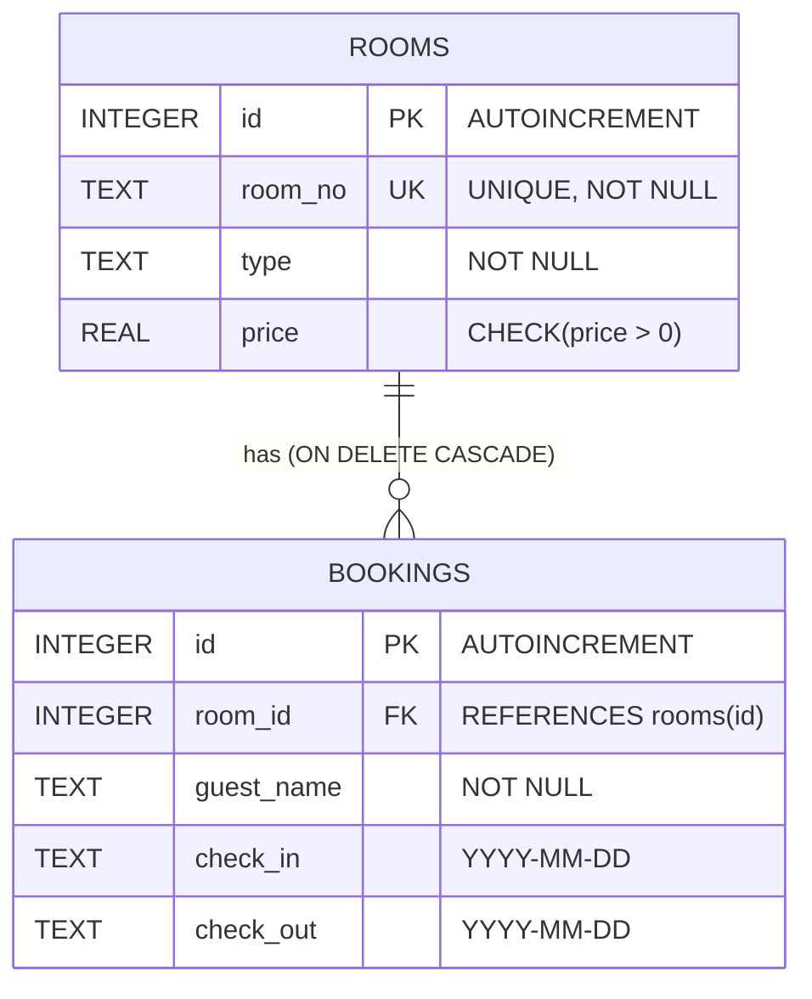

# Hotel Room Booking System

A full-stack web application built for college project submission. This system allows hotel staff to manage hotel rooms, check real-time availability, search for open rooms by date range, and book reservations while strictly preventing overlapping double-bookings.

---

## 🎯 Aim of the Project

The goal of this project is to create a complete, reliable, and user-friendly Hotel Room Booking System from scratch using foundational web technologies without relying on complex frameworks. It demonstrates:
- Building RESTful APIs with Node.js and Express.
- Relational database design and integrity constraints using SQLite and `better-sqlite3`.
- Strict conflict detection logic for overlapping date ranges.
- Dynamic Single-Page Application (SPA) UI updates using vanilla JavaScript and `fetch()`.

---

## 🛠️ Tech Stack

* **Frontend**: Plain HTML5, CSS3, Vanilla JavaScript (ES6+) — *No React, No external UI libraries*
* **Backend**: Node.js & Express.js
* **Database**: SQLite3 managed through `better-sqlite3` (with Write-Ahead Logging `WAL` mode enabled)
* **Architecture**: REST API with static file serving

---

## ✨ Features

1. **Room Management**:
   * Add new rooms with Room Number, Category (Single, Double, Deluxe, Suite), and Nightly Price.
   * Edit existing room details using an interactive modal window (`PUT`).
   * Delete rooms with confirmation prompts.
2. **Dynamic Live Availability**:
   * Displays all rooms with a color-coded status badge (**Available** in green, **Booked** in orange) based on today's date.
   * Availability is calculated dynamically in real-time.
3. **Smart Room Search**:
   * Search and filter rooms by room type and specific check-in / check-out dates.
   * Excludes any room with a conflicting reservation during the requested period.
4. **Guest Reservations & Conflict Prevention**:
   * Book a room for a guest with check-in and check-out dates.
   * **Guaranteed Double-Booking Prevention**: Atomically rejects any reservation that overlaps with an existing booking.
   * **Same-Day Turnover Support**: A new guest can check in on the same day an earlier guest checks out.
   * Calculates total nights and total stay cost automatically.
5. **Booking Cancellation**:
   * Cancel reservations with a single click, instantly restoring room availability.
6. **User Interface & Security**:
   * **No Page Reloads**: All actions use `fetch()` to update tables and dropdowns dynamically.
   * **Self-Dismissing Alerts**: Toast notifications (green for success, red for errors) auto-hide after 4 seconds.
   * **XSS Protection**: All untrusted user inputs are sanitized before rendering into the DOM.
   * **Input Constraints**: Date inputs automatically disable past dates (`min` set to today).

---

## 📂 Project Structure

```text
Hotel REservation SYstem/
├── public/                  # Frontend client assets
│   ├── index.html           # Main user interface & modal markup
│   ├── style.css            # Responsive blue-themed styles & animations
│   └── app.js               # Client-side JavaScript (API calls, DOM updates)
├── routes/                  # Express REST API routes
│   ├── bookings.js          # Booking endpoints & overlap logic
│   └── rooms.js             # Room CRUD & search endpoints
├── .gitignore               # Ignores node_modules/ and *.db
├── db.js                    # SQLite connection & table initialization
├── hotel.db                 # SQLite database file (created automatically)
├── package.json             # Project metadata, dependencies, and npm scripts
├── server.js                # Express server entry point
├── tests.js                 # Automated API test suite
└── README.md                # Project documentation
```

---

## 🚀 How to Install and Run

### Prerequisites
Make sure you have [Node.js](https://nodejs.org/) (version 18 or higher) installed on your computer.

### Step 1: Clone or Navigate to the Folder
Open your terminal (PowerShell, Command Prompt, or Bash) in the project directory:
```bash
cd "Hotel REservation SYstem"
```

### Step 2: Install Dependencies
Install Express and `better-sqlite3`:
```bash
npm install
```

### Step 3: Start the Application
Start the Node.js server:
```bash
npm start
```
You should see:
```text
Hotel Reservation server running at http://localhost:3000
```

### Step 4: Open in Your Browser
Open your browser and visit:
👉 **[http://localhost:3000](http://localhost:3000)**

---

## 🧪 Running Automated Tests

The project includes an automated test runner written with Node's native `fetch` API:

```bash
npm test
```

This script tests all 10 edge cases against the running server, logs **PASS/FAIL** for each test, and automatically cleans up test data upon completion.

---

## ☁️ Deployment on Render

This application is ready for zero-config deployment on [Render](https://render.com):

1. **Sign in to Render**: Connect your GitHub account at [dashboard.render.com](https://dashboard.render.com).
2. **Create a New Web Service**: Click **New +** $\rightarrow$ **Web Service**.
3. **Select Repository**: Select `24rautsp/hotel-booking-system`.
4. **Configuration Settings**:
   * **Name**: `hotel-booking-system`
   * **Region**: Choose the closest region (e.g., Singapore, Frankfurt, Oregon)
   * **Branch**: `main`
   * **Runtime**: `Node`
   * **Build Command**: `npm install`
   * **Start Command**: `npm start`
   * **Instance Type**: **Free**
5. **Click "Deploy Web Service"**.

> [!WARNING]
> **Important Note on SQLite on Free Cloud Hosting (Ephemeral Storage)**:  
> Render Free instances use **ephemeral disks**. When the server spins down due to 15 minutes of inactivity or redeploys, SQLite files are reset. For this college project, the app automatically initializes 3 default starter rooms (`101`, `102`, `201`) whenever the database is created, ensuring the demo is always immediately playable. For permanent long-term production storage, you can attach a Render Persistent Disk or connect a hosted PostgreSQL database.

---

## 📡 API Endpoints Reference

All API routes communicate using JSON and standard HTTP status codes.

| Method | Endpoint | Description | Status Codes |
|---|---|---|---|
| `GET` | `/api/health` | Check if the backend is running | `200` |
| `GET` | `/api/rooms` | List all rooms with today's status | `200`, `500` |
| `GET` | `/api/rooms/search` | Search available rooms by date and type | `200`, `400`, `500` |
| `POST` | `/api/rooms` | Add a new room | `201`, `400`, `409`, `500` |
| `PUT` | `/api/rooms/:id` | Update an existing room | `200`, `400`, `404`, `409`, `500` |
| `DELETE` | `/api/rooms/:id` | Delete a room (cascades to bookings) | `200`, `404`, `500` |
| `GET` | `/api/bookings` | List all bookings with room details & totals | `200`, `500` |
| `POST` | `/api/bookings` | Create a new reservation | `201`, `400`, `404`, `409`, `500` |
| `DELETE` | `/api/bookings/:id` | Cancel an existing booking | `200`, `404`, `500` |

---

### Request & Response Examples

#### 1. Add a Room (`POST /api/rooms`)
**Request Body:**
```json
{
  "room_no": "101",
  "type": "Single",
  "price": 99.00
}
```
**Response (`201 Created`):**
```json
{
  "message": "Room added successfully",
  "room": {
    "id": 1,
    "room_no": "101",
    "type": "Single",
    "price": 99.00
  }
}
```

#### 2. Search Available Rooms (`GET /api/rooms/search?check_in=2026-11-10&check_out=2026-11-15&type=Deluxe`)
**Response (`200 OK`):**
```json
[
  {
    "id": 2,
    "room_no": "102",
    "type": "Deluxe",
    "price": 150.00,
    "status": "Available"
  }
]
```

#### 3. Create a Booking (`POST /api/bookings`)
**Request Body:**
```json
{
  "room_id": 1,
  "guest_name": "Alice Smith",
  "check_in": "2026-11-10",
  "check_out": "2026-11-15"
}
```
**Response (`201 Created`):**
```json
{
  "message": "Booking created successfully",
  "booking": {
    "id": 1,
    "room_id": 1,
    "guest_name": "Alice Smith",
    "check_in": "2026-11-10",
    "check_out": "2026-11-15",
    "nights": 5,
    "room_no": "101",
    "room_type": "Single",
    "room_price": 99.00,
    "total_price": 495.00
  }
}
```

#### 4. Double Booking Conflict (`POST /api/bookings`)
If another reservation attempts to book Room 1 during an overlapping date range (e.g., Nov 12 to Nov 14):

**Response (`409 Conflict`):**
```json
{
  "error": "Room 101 is already booked by Alice Smith from 2026-11-10 to 2026-11-15. Overlapping dates are not allowed."
}
```

---

## 🗄️ Database Schema

The database is powered by SQLite (`hotel.db`) with relational integrity enabled (`PRAGMA foreign_keys = ON;`).



### Table Details

1. **`rooms` Table**:
   * `id`: Auto-incrementing numerical primary key.
   * `room_no`: Unique room identifier (e.g., `"101"`, `"204B"`).
   * `type`: Category (`Single`, `Double`, `Deluxe`, `Suite`).
   * `price`: Nightly rate, protected by a `CHECK(price > 0)` constraint.

2. **`bookings` Table**:
   * `id`: Auto-incrementing numerical primary key.
   * `room_id`: Foreign key pointing to `rooms.id`.
   * `guest_name`: Name of the guest.
   * `check_in` & `check_out`: Text columns formatted as `YYYY-MM-DD` (ISO 8601).
   * `ON DELETE CASCADE`: If a room is removed, SQLite automatically cleans up all associated booking records.

> **Why availability is not stored in a database column:**  
> A room is not permanently "free" or "occupied"—availability depends entirely on dates. A room can be booked for next week while remaining completely free today. Storing a static boolean flag would lead to outdated data. Instead, the system checks the `bookings` table dynamically whenever a date range is requested.

---

## 🛡️ Edge Cases & Conflict Prevention

### The Overlap Formula
Two stays overlap if and only if:
$$\text{existing.check\_in} < \text{new.check\_out} \quad \text{AND} \quad \text{existing.check\_out} > \text{new.check\_in}$$

| Scenario | Existing Dates | New Booking | Overlap? | Result |
|---|---|---|---|---|
| Inside Range | Nov 10 – Nov 15 | Nov 11 – Nov 14 | **Yes** | ❌ Rejected (`409 Conflict`) |
| Starts Before, Ends Inside | Nov 10 – Nov 15 | Nov 08 – Nov 12 | **Yes** | ❌ Rejected (`409 Conflict`) |
| Starts Inside, Ends After | Nov 10 – Nov 15 | Nov 13 – Nov 18 | **Yes** | ❌ Rejected (`409 Conflict`) |
| Encloses Entire Stay | Nov 10 – Nov 15 | Nov 05 – Nov 20 | **Yes** | ❌ Rejected (`409 Conflict`) |
| **Same-Day Turnover (After)** | Nov 10 – Nov 15 | **Nov 15** – Nov 20 | **No** | ✅ Allowed (`201 Created`) |
| **Same-Day Turnover (Before)** | Nov 10 – Nov 15 | Nov 05 – **Nov 10** | **No** | ✅ Allowed (`201 Created`) |

### Additional Validations Handled
* **Chronological Order**: `check_out` earlier than or equal to `check_in` returns `400 Bad Request`.
* **Historical Dates**: Selecting check-in dates in the past returns `400 Bad Request`.
* **Empty / Whitespace Input**: Blank guest names or room numbers are rejected with `400 Bad Request`.
* **Duplicate Room Numbers**: Attempting to add an existing room number returns `409 Conflict`.
* **Missing Records**: Modifying or deleting a non-existent room or booking returns `404 Not Found`.
* **Concurrency Protection**: Overlap verification and booking insertion are executed inside an atomic SQLite transaction (`db.transaction()`), preventing race conditions.

---

## 📜 License
This project was developed for educational purposes as a college computer science / full-stack web development assignment.
